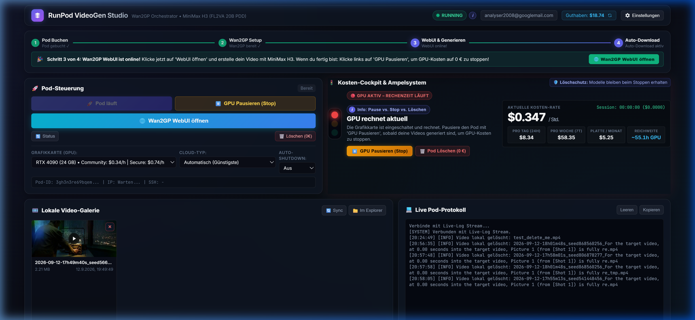
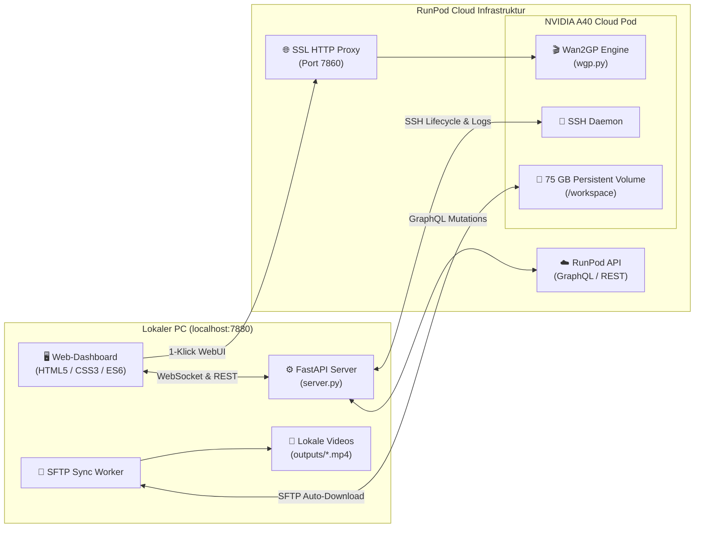
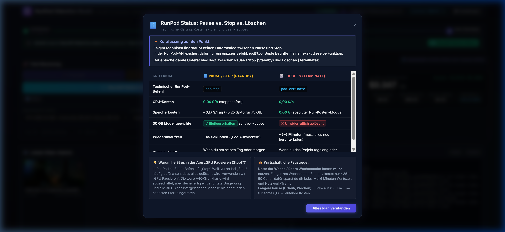
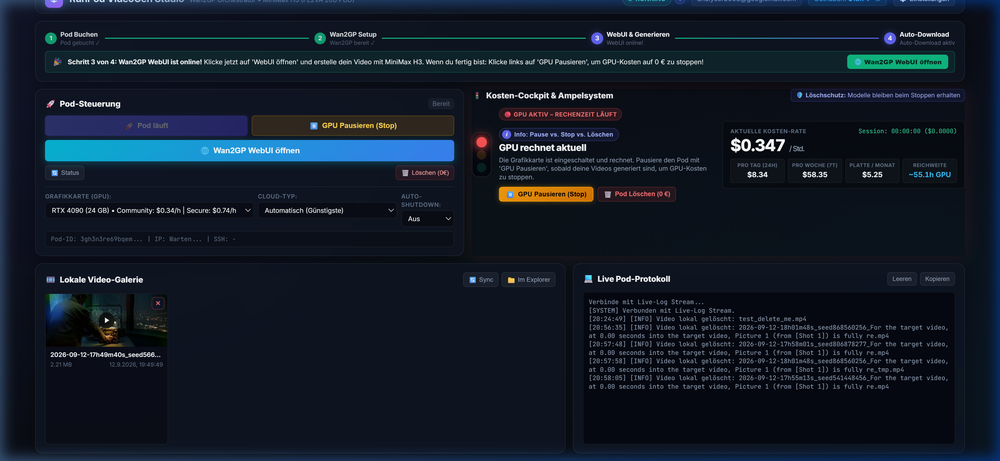

# 🚀 RunPod VideoGen Studio

<div align="center">

[](https://fastapi.tiangolo.com/)
[](https://python.org/)
[](https://runpod.io/)
[](https://developer.nvidia.com/cuda-zone)
[](https://github.com/kijai/ComfyUI-WanVideoWrapper)
[](LICENSE)

**Professionelles Steuerungs-Dashboard zur automatisierten Bereitstellung, Kostenkontrolle und Orchestrierung von RunPod-GPU-Instanzen für die Video-Generierung mit [Wan2GP](https://github.com/deepseek-ai) und dem 20-Milliarden-Parameter-Modell MiniMax H3 (FL2VA PDD 8-Step).**

</div>

---

## 📸 Dashboard Übersicht



---

## 📋 Inhaltsverzeichnis

- [✨ Kern-Features](#-kern-features)
- [🏗️ Systemarchitektur](#️-systemarchitektur)
- [💰 Kosten-Cockpit & Ampelsystem](#-kosten-cockpit--ampelsystem)
- [⏸️ Pause vs. Stop vs. Löschen](#️-pause-vs-stop-vs-löschen)
- [🎥 Video-Galerie & Auto-Sync](#-video-galerie--auto-sync)
- [⚡ Performance-Benchmarks](#-performance-benchmarks)
- [🛠️ Schnellstart & Installation](#️-schnellstart--installation)
- [📁 Verzeichnisstruktur](#-verzeichnisstruktur)
- [📚 Weiterführende Dokumentation](#-weiterführende-dokumentation)

---

## ✨ Kern-Features

* **Komfortables Dark-Mode Glassmorphism Dashboard:**
  - Echtzeit-Statusüberwachung des Cloud-Pods via WebSockets und REST.
  - Sekundengenauer Session-Kosten-Tracker und Live-Berechnung verbleibender GPU-Laufzeit.
* **Intelligentes 3-Stufen Ampelsystem:**
  - **🔴 Rot:** GPU aktiv und rechnet (Rechenzeit läuft).
  - **🟡 Gelb:** GPU pausiert im Standby (0,00 $/h GPU-Kosten, alle 30 GB Modelle bleiben auf der Cloud-Platte erhalten).
  - **🟢 Grün:** 0,- € Null-Kosten Modus (Pod und Volume gelöscht, absolut keine laufenden Gebühren).
* **Direkt-Aktionen im Cockpit:**
  - `[ ⏸️ GPU Pausieren (Stop) ]`, `[ ⚡ Pod Aufwecken (45s) ]`, `[ 🗑️ Pod Löschen (0 €) ]`.
  - Anklickbare Info-Buttons (`ℹ️`) mit sofortiger Erklärung aller Kostenfaktoren.
* **Automatische Video-Synchronisation:**
  - Ein SFTP-Hintergrunddienst lädt neu generierte Videos automatisch vom Cloud-Pod direkt auf deinen lokalen PC in den Ordner `outputs/`.
  - 2-stufiger Löschmechanismus (löscht synchron lokal und im Remote-Cache).
* **Vollautomatisches Bootstrapping:**
  - Kein manuelles Einrichten per SSH nötig.
  - Automatischer Triton 3.0.0 JIT-Patch und PyTorch 2.5 `nn.Buffer`-Polyfill für fehlerfreie Ausführung von `mmaudio` und MiniMax H3.
* **Kostenschutz-Watchdog:**
  - Wählbarer Auto-Shutdown-Timer (z. B. nach 30 Minuten Inaktivität) schaltet die GPU automatisch ab.
  - 🔄 Guthaben-Refresh-Button zur Live-Abfrage des aktuellen RunPod-Kontostands.

---

## 🏗️ Systemarchitektur



---

## 💰 Kosten-Cockpit & Ampelsystem

Das Kosten-Cockpit schützt transparent vor unerwarteten Cloud-Rechnungen.



### 🔴 Rot: GPU Aktiv
- Die Grafikkarte rechnet (z. B. 0,84 $/h bei A40 Secure Cloud).
- Die Live-Stoppuhr zählt Uptime und Session-Kosten in Echtzeit.

### 🟡 Gelb: Standby (GPU aus, Modelle erhalten)
- GPU ist abgeschaltet (**0,00 $/h**).
- Das 75 GB Cloud-Volume bleibt gespeichert (**~0,17 $/Tag**).
- **Vorteil:** Schneller Neustart in ca. 45 Sekunden ohne erneuten 30 GB Download.

### 🟢 Grün: 0,- € Null-Kosten Modus
- Pod und Volume sind gelöscht.
- Laufende Kosten: **exakt 0,00 €**.

---

## ⏸️ Pause vs. Stop vs. Löschen

> [!NOTE]
> **Gibt es technisch einen Unterschied zwischen Pause und Stop?**  
> **Nein.** In RunPod existiert nur ein einziger Befehl: `podStop`. Pause und Stop sind technisch identisch.

Der eigentliche Unterschied liegt zwischen **Standby (Pause/Stop)** und **Löschen (Terminate)**:

| Kriterium | ⏸️ Pause / Stop (Standby) | 🗑️ Löschen (Terminate) |
| :--- | :--- | :--- |
| **Technischer Befehl** | `podStop` | `podTerminate` |
| **GPU-Kosten** | **0,00 $/h** (stoppt sofort) | **0,00 $/h** |
| **Speicherkosten** | **~0,17 $/Tag** (~5,25 $/Mo für 75 GB) | **0,00 €** (Null-Kosten-Modus) |
| **30 GB Modellgewichte** | **Bleiben erhalten** auf `/workspace` | **Werden unwiderruflich gelöscht** |
| **Wiederanlaufzeit** | **~45 Sekunden** („Pod Aufwecken“) | **~5–6 Minuten** (muss alles neu laden) |
| **Empfehlung** | Wenn du am selben Tag oder morgen weiterrenderst. | Bei längerer Pause (Urlaub, Wochen). |

---

## 🎥 Video-Galerie & Auto-Sync



- **Automatische Synchronisation:** Sobald Wan2GP ein Video gerendert hat, wird es im Hintergrund auf den lokalen Rechner nach `outputs/` übertragen.
- **Integrierter Video-Player:** Videos können sofort im Browser abgespielt oder im Vollbild betrachtet werden.
- **2-Wege-Löschen:** Löschen in der Galerie entfernt die Datei lokal und im Remote-Cache auf dem Pod.
- **1-Klick Explorer:** Öffnet den Windows-Ordner mit den exportierten Videos.

---

## ⚡ Performance-Benchmarks

Benchmarks mit **MiniMax H3 FL2VA Pruned 20B (PDD 8-Step)** auf einer **NVIDIA A40 (48 GB VRAM)**:

| Auflösung | Pixel pro Frame | Zeit pro Step | Gesamtdauer (8 Steps) | Praxistipp |
| :--- | :--- | :--- | :--- | :--- |
| **256p** (`448x256`) | 114.688 | ~4.9s | **~39 Sekunden** | Schnelltests & Motion-Checks |
| **480p** (`832x480`) | 399.360 | ~14.5s | **~1.9 Minuten** | **Standard:** Beste Balance aus Qualität & Speed |
| **720p** (`1280x720`) | 921.600 | ~58.0s | **~7.7 Minuten** | Hochwertige Renderings |
| **1080p** (`1920x1088`) | 2.088.960 | ~260.0s | **~32 Minuten** | Finales Mastering |

---

## 🛠️ Schnellstart & Installation

### Voraussetzungen
- Python 3.10 oder höher
- RunPod Account & API-Key ([runpod.io](https://www.runpod.io))
- SSH-Keypair für die Remote-Verbindung

### 1. Repository klonen & Abhängigkeiten installieren
```bash
git clone https://github.com/dein-user/RunPodVideogen.git
cd RunPodVideogen
pip install -r requirements.txt
```

*(Benötigte Bibliotheken: `fastapi`, `uvicorn`, `paramiko`, `httpx`, `websockets`)*

### 2. Konfiguration anlegen
Kopiere `config.example.json` zu `config.json` und trage deinen API-Key ein:
```json
{
  "runpod_api_key": "DEIN_RUNPOD_API_KEY",
  "account_balance": 18.74,
  "default_gpu": "NVIDIA A40",
  "volume_disk_gb": 75,
  "auto_shutdown_minutes": 30,
  "standby_mode": "stop"
}
```
*(Die Datei `config.json` ist per `.gitignore` und Pre-Commit-Hook vor unbeabsichtigtem Einchecken geschützt).*

### 3. Server starten
Unter Windows genügt ein Doppelklick auf:
```cmd
start.bat
```
Oder manuell in der Konsole:
```bash
python server.py
```

Öffne anschließend im Browser:
```
http://localhost:7880
```

---

## 📁 Verzeichnisstruktur

```
RunPodVideogen/
├── backend/                  # Python Backend Module
│   ├── orchestrator.py       # RunPod GraphQL & Lifecycle Management
│   ├── ssh_client.py         # SSH Befehlsausführung & SFTP Sync
│   └── ...
├── doc/                      # Technische Dokumentation
│   ├── architecture.md       # Detaillierte Systemarchitektur
│   ├── cost_management.md    # Kostenmodelle, Formeln & Watchdog
│   └── setup_troubleshooting.md # Bugfixes, Patches & Benchmarks
├── docs/
│   └── images/               # Screenshots für GitHub & Dokumentation
├── outputs/                  # Lokale Synchronisation der gerenderten MP4s
├── scripts/                  # Cloud-Skripte
│   └── bootstrap_pod.sh      # Automatisches Setup auf dem RunPod
├── static/                   # Web-Frontend
│   ├── css/style.css         # Glassmorphism Design & Responsive Layout
│   ├── js/app.js             # UI Controller, State & Event-Handling
│   └── index.html            # Dashboard Struktur & Modals
├── config.example.json       # Vorlage für Konfiguration
├── README.md                 # Hauptdokumentation (diese Datei)
├── server.py                 # FastAPI Webserver & API Router
└── start.bat                 # 1-Klick Windows Starter
```

---

## 📚 Weiterführende Dokumentation

- [🏗️ Detaillierte Systemarchitektur (doc/architecture.md)](doc/architecture.md)
- [💰 Kosten-Management & Ampelsystem (doc/cost_management.md)](doc/cost_management.md)
- [🔧 Setup, Fehlerbehebung & Performance-Patches (doc/setup_troubleshooting.md)](doc/setup_troubleshooting.md)

---

## 📄 Lizenz

Dieses Projekt ist unter der **MIT-Lizenz** lizenziert.
