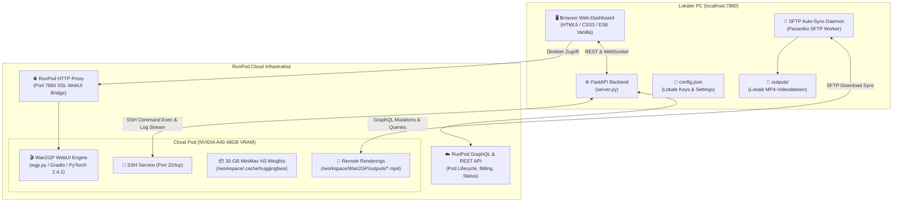

# 🏗️ Systemarchitektur & Technische Dokumentation

Das **RunPod VideoGen Studio** ist ein hybrides Orchestrierungs-System, das ein lokales Web-Dashboard mit Cloud-GPU-Instanzen auf RunPod verbindet.

---

## 1. Gesamtarchitektur

---

## 2. Komponenten-Übersicht

### A. Backend (`server.py`)
Das Backend ist als asynchroner **FastAPI**-Dienst aufgebaut:
* **Lifecycle-Management:**
  - `POST /api/pod/start`: Bucht neue GPU via RunPod GraphQL API oder reaktiviert einen bestehenden `STOPPED` Pod (`podResume`).
  - `POST /api/pod/stop`: Fährt die GPU herunter (`podStop`), entlässt die Kosten und hält die Festplatte im Standby.
  - `POST /api/pod/terminate`: Löscht Pod und Volume unwiderruflich (`podTerminate`) für 0,- € Kosten.
* **Status & Billing:**
  - `GET /api/status`: Pollt Pod-Zustand, Uptime, Live-Kosten und Proxy-URL.
  - `GET /api/account/refresh`: Fragt das aktuelle RunPod-Guthaben direkt vom RunPod Account-Endpoint ab.
* **Auto-Sync & Galerie:**
  - Ein permanenter Hintergrund-Worker scannt per SSH/SFTP das Remote-Verzeichnis `/workspace/Wan2GP/outputs/` und überträgt fertig gerenderte `.mp4`-Dateien automatisch in das lokale Verzeichnis `outputs/`.
  - `POST /api/videos/delete`: Löscht das Video synchron auf dem lokalen Dateisystem **und** per SSH auf dem Remote-Pod, um ein erneutes Herunterladen zu verhindern.
* **Live-Log Streaming:**
  - WebSocket-Endpoint `/ws/logs`: Streamt Ausgaben von `tail -f /workspace/wan2gp.log` in Echtzeit an das Dashboard.

---

### B. Frontend (`static/`)
* **Architektur:** Reine Vanilla-Technologien (HTML5, modernes CSS3 mit Variablen und Glassmorphism, ES6 JavaScript) ohne schwere Framework-Abhängigkeiten.
* **Kosten-Cockpit:**
  - 3-Stufen Ampelsystem (Rot, Gelb, Grün).
  - Integrierte Direkt-Aktionen: `[ ⏸️ GPU Pausieren ]`, `[ ⚡ Pod Aufwecken ]`, `[ 🗑️ Pod Löschen ]`.
  - Anklickbare Info-Buttons (`i`) für den Detail-Vergleich (Pause vs. Stop vs. Löschen).
* **Video-Galerie:**
  - Thumbnail-Vorschau mit Video-Player Modal.
  - Zweistufiger Löschmechanismus mit Inline-Bestätigung (kein störendes Browser-Alert).
  - 1-Klick-Button zum Öffnen des Windows-Dateiexplorers (`POST /api/videos/open-folder`).

---

### C. Cloud Pod-Umgebung
* **Container-Image:** Offizielles PyTorch Container-Image von RunPod (`runpod/pytorch:2.4.0-py3.11-cuda12.4.1-devel-ubuntu22.04`).
* **Hardware:** NVIDIA A40 (48 GB VRAM), 75 GB Persistent Cloud Volume.
* **Bootstrap Skript ([scripts/bootstrap_pod.sh](file:///d:/AntiGravitySoftware/GitWorkspace/RunPodVideogen/scripts/bootstrap_pod.sh)):**
  - Klonen von Wan2GP nach `/workspace/Wan2GP`.
  - Setzen von `HF_HOME=/workspace/.cache/huggingface` (verhindert Datenverlust bei Neustarts).
  - **Triton 3.0.0 Patch:** Entfernt inkompatible JIT-Parameter transparent im Wrapper.
  - **PyTorch 2.5 Buffer-Polyfill:** Simuliert `nn.Buffer` für `mmaudio` und MiniMax H3.
  - Entkoppelter Hintergrundstart via `setsid python wgp.py --server-port 7860 --server-name 0.0.0.0`.

---

## 3. Sicherheits- und Persistenzkonzept

1. **Keine Secrets in Git:**
   - Alle sensiblen Daten (RunPod API Key, persönliche Account-Daten) liegen ausschließlich in der lokalen Datei `config.json`.
   - `config.json` ist in `.gitignore` eingetragen.
   - Ein Git Pre-Commit Hook (`.git/hooks/pre-commit`) scannt jeden Commit und blockiert das Einchecken von RunPod-Schlüsseln (`rpa_...`).
2. **Schutz vor versehentlichem Datenverlust:**
   - Das Löschen von Pods (`podTerminate`) wird niemals automatisiert ausgeführt, sondern erfordert immer die manuelle Nutzerbestätigung.
   - Der normale Workflow pausiert den Pod lediglich (`podStop`), wodurch alle 30 GB heruntergeladenen Modelle auf `/workspace` geschützt bleiben.
