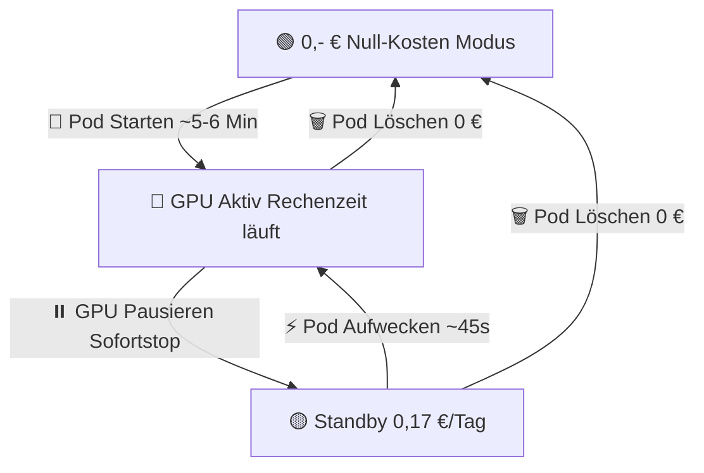

# 💰 Kosten-Management & Ampelsystem (RunPod VideoGen Studio)

Dieses Dokument erklärt das Kostenmodell von RunPod, die im Studio implementierten Sicherheitsmechanismen sowie die genauen Unterschiede zwischen den Betriebsmodi (**Aktiv**, **Standby/Pause** und **Null-Kosten/Löschen**).

---

## 1. RunPod Kostenstruktur im Überblick

RunPod berechnet Ressourcen nach zwei getrennten Kategorien:

1. **GPU-Rechenzeit (Stundensatz):**
   - Wird sekundengenau abgerechnet, solange der Pod im Status `RUNNING` ist.
   - Typische Sätze:
     - **NVIDIA A40 (48 GB VRAM):** ca. `0,35 $` bis `0,84 $` pro Stunde (Community vs. Secure Cloud).
     - **RTX 4090 (24 GB VRAM):** ca. `0,44 $` bis `0,74 $` pro Stunde.
   - **Wichtig:** Sobald der Pod pausiert (`STOPPED`) oder beendet wird, sinken die GPU-Kosten sofort auf **exakt 0,00 $/h**.

2. **Persistent Volume Storage (Cloud-Platte `/workspace`):**
   - RunPod berechnet persistente Festplatten mit pauschal **0,07 $ pro GB und Monat**.
   - Für das MiniMax H3 Modell (inklusive Caches, Pip-Paketen und Ausgabevideos) sind **75 GB** reserviert:
     $$\text{Kosten pro Monat} = 75 \times 0{,}07\,\$ = 5{,}25\,\$$$
     $$\text{Kosten pro Tag} = \frac{5{,}25\,\$}{30} \approx 0{,}175\,\$ \quad (\text{ca. 17 Cent})$$
     $$\text{Kosten pro Stunde} \approx 0{,}0073\,\$$$

---

## 2. Das 3-Stufen Ampelsystem im Studio

Das Studio visualisiert jederzeit transparent und in Echtzeit, in welchem Kostenstatus sich das System befindet:

### 🔴 Rot: GPU Aktiv (Rechenzeit läuft)
* **Status:** `RUNNING` oder `BOOTSTRAPPING`
* **GPU-Kosten:** z. B. `0,84 $/h`
* **Speicherkosten:** `0,007 $/h`
* **Gesamtrate:** `~0,847 $/h`
* **Bedeutung:** Die Grafikkarte rechnet aktiv. Die Live-Stoppuhr im Cockpit zählt die Session-Kosten sekundengenau hoch. Sobald alle gewünschten Videos gerendert sind, sollte die GPU pausiert werden.

### 🟡 Gelb: Standby (GPU pausiert, 30 GB Modelle erhalten)
* **Status:** `STOPPED` (Pod-ID existiert weiterhin)
* **GPU-Kosten:** **0,00 $/h**
* **Speicherkosten:** **~0,17 $/Tag** (~5,25 $/Monat)
* **Bedeutung:** Die teure Grafikkarte ist abgeschaltet und kostet keinen Cent mehr. Das 75 GB Cloud-Volume bleibt eingefroren erhalten.
* **Vorteil:** Bei erneutem Bedarf klickst du auf **„⚡ Pod Aufwecken“** und bist in **~45 Sekunden** wieder startklar, ohne 30 GB Modelle erneut herunterladen zu müssen.

### 🟢 Grün: 0,- € Null-Kosten Modus
* **Status:** `OFFLINE` oder `TERMINATED`
* **GPU-Kosten:** **0,00 $/h**
* **Speicherkosten:** **0,00 $/h** (exakt 0,00 €/Tag)
* **Bedeutung:** Kein Pod aktiv, keine Festplatte reserviert. Dein Guthaben bleibt zu 100 % unangetastet.
* **Neustart:** Ein neuer Start erfordert die vollständige Neu-Bereitstellung inkl. Download aller 30 GB Modellgewichte (dauert ca. 5–6 Minuten).

---

## 3. Vergleichstabelle: Pause vs. Stop vs. Löschen

| Kriterium | ⏸️ Pause / Stop (Standby) | 🗑️ Löschen (Terminate) |
| :--- | :--- | :--- |
| **Technischer RunPod-Befehl** | `podStop` | `podTerminate` |
| **GPU-Kosten** | **0,00 $/h** (stoppt sofort) | **0,00 $/h** |
| **Speicherkosten** | **~0,17 $/Tag** (~5,25 $/Mo für 75 GB) | **0,00 €** (absoluter Null-Kosten-Modus) |
| **30 GB Modellgewichte** | **Bleiben erhalten** auf `/workspace` | **Werden unwiderruflich gelöscht** |
| **Wiederanlaufzeit** | **~45 Sekunden** („Pod Aufwecken“) | **~5–6 Minuten** (muss alles neu herunterladen) |
| **Wann nutzen?** | Wenn du am selben Tag oder morgen weiterarbeiten willst. | Wenn du das Projekt tagelang oder wochenlang nicht nutzt. |

> [!NOTE]
> **Gibt es einen Unterschied zwischen Pause und Stop?**  
> Technisch: **Nein, absolut keinen.** In der RunPod GraphQL API existiert ausschließlich der Befehl `podStop`.  
> In der Studio-UI verwenden wir die Bezeichnung **„GPU Pausieren (Stop)“**, um Missverständnisse zu vermeiden: Anwender vermuten bei „Stop“ oft fälschlicherweise, dass ihre Festplatte oder Daten gelöscht werden.

---

## 4. Automatischer Schutz vor Kostenfallen

1. **Inaktivitäts-Watchdog (Auto-Shutdown):**
   - Im Dashboard kann eine automatische Abschaltzeit definiert werden (z. B. 15, 30, 45 oder 60 Minuten).
   - Registriert das System keine neuen Render-Aufträge oder Nutzeraktivität, fährt der Watchdog den Pod automatisch in den Standby-Modus (`podStop`).

2. **Live-Guthaben & RunPod-Refresh:**
   - Rechts oben in der Menüleiste wird das RunPod-Guthaben angezeigt.
   - Der 🔄 Refresh-Button fragt das aktuelle Echtzeit-Guthaben direkt über die RunPod User-API ab.

3. **Zweistufige Löschbestätigung:**
   - Weder ein Pod noch generierte Videos können versehentlich mit einem einzigen Klick gelöscht werden.
   - Sowohl der Lösch-Button im Cockpit als auch das `×` in der Video-Galerie verlangen eine explizite zweite Bestätigung.
